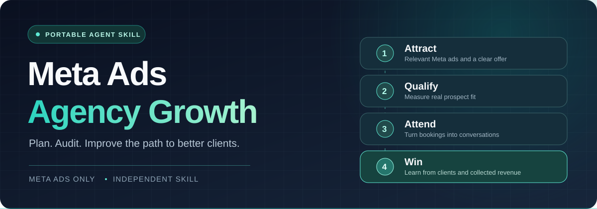

<p align="center"></p>

<h1 align="center">Meta Ads Skills for Digital Agency</h1>

<p align="center">A portable Agent Skill for digital agencies that want to plan, audit, and improve Meta Ads client acquisition.</p>

<p align="center">
  <a href="meta-ads-agency-growth/SKILL.md"></a>
  <a href="LICENSE"></a>
</p>

<p align="center"><a href="#install">Install</a> · <a href="#what-the-skill-does">What it does</a> · <a href="#try-it">Try it</a></p>

---

## The idea

An agency needs more than cheap leads. This skill helps an AI agent follow the path from **Meta ad → qualified prospect → attended conversation → client**, using the agency's own economics and funnel data. It focuses on Facebook and Instagram advertising for agencies acquiring clients or delivering Meta Ads services.

| Start with | Work through | Get back |
| --- | --- | --- |
| Your offer, target client, budget, margins, account or export data, and funnel stages | Offer and creative, qualification, tracking, attendance, sales, and delivery | A plan or audit with evidence, priorities, bounded tests, owners, and review points |

## What the skill does

It follows an operating sequence: **strategy and offer → funnel and tracking → image and video creative → Meta setup → launch QA → qualified lead and appointment handling → optimization → ongoing creative and account care**. Each stage has an output and a completion check in the [runbook](meta-ads-agency-growth/references/appointment-operating-runbook.md). A VSL is used when it helps explain the offer; the process does not depend on a course, coaching call, or chat support.

- **Validate before scaling:** check buyer demand, derive appointment cost targets from margins and sales rates, and decide whether to continue, revise, stop, or scale using mature cohort results.
- **Build and assess the offer first:** turn an agency's real services, buyer evidence, capacity, and economics into package options; choose one to validate, then return a reasoned verdict before writing ads.
- **Plan acquisition:** define a credible offer, target prospect, budget, funnel, and measurement plan.
- **Develop image and video ads:** plan both formats and compare them against qualified appointment outcomes.
- **Audit the full path:** find where clicks, leads, bookings, attended calls, and clients diverge.
- **Improve with evidence:** propose creative and funnel tests based on actual constraints, rather than copied account settings or promised results.
- **Optimize toward qualified appointments:** define prospect fit, send the qualified booked-appointment outcome back from the CRM when supported, and evaluate booked and attended calls instead of raw lead volume alone.
- **Support agency delivery:** connect client acquisition claims to scope, reporting, and the ability to serve new clients.
- **Run a launch process:** use readiness gates from offer approval to test leads, booking, CRM feedback, launch authorization, and follow-up. Reports distinguish what was verified live from what is only planned or not verified.

It does **not** connect to a Meta Ads account by itself or guarantee appointments, clients, or revenue. An installed skill can prepare plans and reports; inspecting current settings requires authorized account access, and making live changes requires a supported write-capable tool plus authorization for that account and action. Screenshots and exports only support findings about the information and date they contain. Results depend on the offer, market, budget, evidence quality, follow-up, and sales process.

## Install

Install the single skill globally with the [Skills CLI](https://github.com/vercel-labs/skills):

```bash
npx skills add pritoo733/Meta-Ads-Skills-for-Digital-Agency --skill meta-ads-agency-growth -g -y
```

The CLI detects supported agents. To target one explicitly, add `-a codex` or `-a claude-code` before `-y`. Fresh project installs were checked for both Codex and Claude Code. For another agent, check whether it reads the [Agent Skills format](https://agentskills.io/specification) and where it loads skills.

**Manual install:** download the [skill ZIP](dist/meta-ads-agency-growth.zip), extract it, and place the entire `meta-ads-agency-growth` folder in your agent's documented skill directory. Keep `SKILL.md` and `references/` together.

## Try it

Give the agent enough context to make a useful decision. For example:

> Use `meta-ads-agency-growth` to build a Meta Ads acquisition plan for my web design agency. Our service is $3,000 per month, we can onboard four clients per month, and our test budget is $1,500. Show the assumptions and the numbers we need to track.

> Use `meta-ads-agency-growth` to help my agency choose a Meta Ads service offer. Here are our services, target industries, delivery capacity, costs, and client results. Build two or three realistic packages, compare them, and show what we must validate before running ads.

> Use `meta-ads-agency-growth` to audit this Meta Ads export, landing page, and CRM stage report. Explain why booked calls are not becoming clients, and rank the next three tests.

> Use `meta-ads-agency-growth` to develop three distinct Meta ad angles from these client interviews and approved case studies. Include the evidence behind each claim.

Actual spend, stage counts, margin, market, reporting period, and account context make the output stronger. The skill labels missing inputs and proposes tests instead of treating outside examples as forecasts.

### Get more useful recommendations

| Give the agent | Why it matters |
| --- | --- |
| Your real offer, ideal client, margin, and sales capacity | Keeps the plan tied to what your agency can sell and deliver. |
| Spend and counts for leads, qualified prospects, bookings, attended calls, and clients | Shows which stage needs attention before changing ads. |
| The date range, attribution setting, and CRM definitions | Keeps unlike numbers from being compared as if they were the same. |
| Approved case studies and customer language | Supports stronger creative without inventing proof. |

Ask for **one prioritized test with a budget cap and review point** when you want a concrete next step.

## What's inside

```text
meta-ads-agency-growth/
├── SKILL.md                         Main instructions and decision boundaries
├── LICENSE                          Skill license
└── references/
    ├── appointment-operating-runbook.md  Readiness gates from offer through follow-up
    ├── agency-workflow.md           Intake, metrics, diagnosis, and deliverables
    ├── acquisition-system.md        A practical framework for the agency acquisition funnel
    ├── validation-and-decisions.md  Offer validation, economic targets, and pilot decisions
    ├── offer-building.md            Turn agency capabilities into testable offer options
    ├── offer-assessment.md          Offer verdict, evidence checks, and research notes
    └── meta-lead-generation.md      Meta lead-quality features and implementation checks
```

## Sources and scope

This is an independent, community-maintained Agent Skill for **Meta Ads only**. It does not promise a particular number of leads, appointments, clients, or revenue. An agent should verify current Meta controls, ad rules, and privacy requirements before changing a live account. The project is not affiliated with or endorsed by Meta.

The skill files are [MIT licensed](LICENSE). Recommendations should be grounded in the agency's own account, funnel, and financial evidence.

---

## Results and testimonials

<p align="center"></p>

We have not published verified testimonials from users of this skill yet. If it helped your agency make a decision or improve a measured outcome, [share your experience](https://github.com/pritoo733/Meta-Ads-Skills-for-Digital-Agency/issues/new?template=share-a-result.yml). Include what you used it for, the result or decision it supported, the period measured, and any evidence you can share. A useful decision is worth sharing even without a revenue result.

<p align="center">
  <a href="https://github.com/pritoo733/Meta-Ads-Skills-for-Digital-Agency/issues/new?template=share-a-result.yml"></a>
</p>

Quotes will be published only with the contributor's permission and enough context to avoid implying a typical or guaranteed outcome. Remove client names and confidential account data unless you have permission to publish them.
